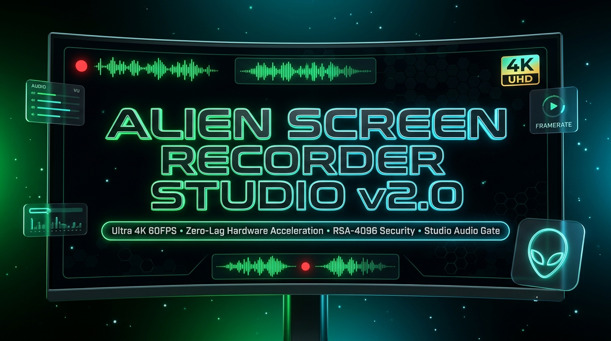

# 👽 Alien Screen Recorder Studio v2.0 (Official Public Release)

> **Next-Gen 4K 60FPS Hardware-Accelerated Screen Recording Studio with Real-Time DSP Audio Gate, Keystroke Visualizer, and Hardware-Locked RSA-4096 Cryptographic Licensing.**
> Built by **Alien Software Development**.

---

## ⚡ Direct Download (v2.0.0)

No internet required after download. Runs out-of-the-box on clean Windows 10 & 11 PCs without installing .NET or any SDKs!

| Package | Type | Description | Download |
| :--- | :---: | :--- | :---: |
| **AlienScreenRecorder-v2.0-Setup-x64.exe** | **Offline Setup** | 100% Standalone Installer with Desktop & Start Menu shortcuts. | [Download Setup](https://github.com/alien-software-development/AlienScreenRecorder/releases/download/v2.0.0/AlienScreenRecorder-v2.0-Setup-x64.exe) |
| **AlienScreenRecorder-v2.0-Portable-x64.zip** | **Portable ZIP** | Zero-installation portable edition. Just extract and run! | [Download Portable](https://github.com/alien-software-development/AlienScreenRecorder/releases/download/v2.0.0/AlienScreenRecorder-v2.0-Portable-x64.zip) |

---

## 🚀 Key Features

* **Ultra 4K UHD 60FPS Capture:**
  * Native DirectX Desktop Duplication API (DXGI) for zero-lag high-framerate captures.
  * Hardware HEVC/H.265 & H.264 video encoding via GPU acceleration.
  * Crash-proof fragmented MP4 (`IsMp4FastStartEnabled`) preventing corrupted files during sudden power loss.

* **Studio DSP Audio Engine:**
  * Real-Time Noise Gate suppressing keyboard clicks, room fan rumble, and background hiss.
  * Dual WASAPI VU Telemetry Meters for system audio & microphone loopback monitoring.
  * AI Studio Voice Isolation & Ducking algorithms.

* **Live Keystroke Visualizer:**
  * Transparent, non-intrusive HUD overlay displaying hotkeys and key presses on screen.

* **Internal Secure Database Vault:**
  * 200% Hardware-Bound Windows DPAPI + AES-256 encrypted SQLite database with HMAC-SHA256 tamper verification.

* **Master RSA-4096 Offline Licensing:**
  * Hardware-fingerprinted cryptographic licensing without any internet activation required.

---

## 💻 System Requirements

* **OS:** Windows 10 (Build 1809+) or Windows 11 (64-bit).
* **Processor:** Intel Core i3 / AMD Ryzen 3 or higher.
* **RAM:** 4 GB minimum (8 GB recommended for 4K).
* **Dependencies:** None! All .NET runtime files and C++ native media codecs are 100% pre-bundled.

---

## 📞 Developer & Support Contact

* **Company:** Alien Software Development
* **WhatsApp:** [+8801710978997](https://wa.me/8801710978997)
* **Website:** [https://aliensoftwaredevelopment.com](https://aliensoftwaredevelopment.com)
* **GitHub:** [https://github.com/alien-software-development](https://github.com/alien-software-development)
